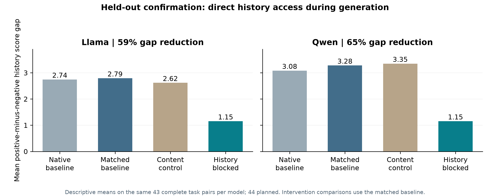

# Completed confirmation: analysis, figures and rebuttal summary

The focused history-reading confirmation is complete and independently audited. The frozen inference code is in [history_reading_confirmation_v1](../history_reading_confirmation_v1/README.md); its Python files and prospective locks are unchanged by this analysis release.

**Completed:** a causal contribution from direct history access during evaluation generation, confirmed on tasks held out from the documented mechanistic sources.

**Still open:** which residual-stream layer or layer range carries that contribution in our free-generation setup. The tentative Llama L12 / Qwen L16 state-swap leads are not validated main carriers. The teammate's layer-window study is complementary and uses a different primary readout. A generated-reader-only layer-range discovery study followed by fresh held-out validation would address the remaining layer question.

## Verified results

Paired means below use the same 43 all-arm-complete tasks per model, from 44 planned tasks. Percentages are ratios of paired mean gap reductions, not fractions of a complete mechanism explained.

| Positive-minus-negative history score gap | Llama | Qwen |
|---|---:|---:|
| Matched baseline | 2.791 | 3.279 |
| Content-key blocking control | 2.616 | 3.349 |
| Generated-reader history blocking | 1.151 | 1.151 |
| Reduction from matched baseline | 58.75% | 64.89% |

Both predeclared outcomes pass in both models using the four-test family and conservative missing-score bounds. All 704 planned records are present; 10 unfinished outputs belong to one task and remain missing. All engineering rechecks, first-prediction boundary checks and within-condition prompt-token checks passed. The native baselines also show large history sensitivity, but do not prove native/explicit-path equivalence.

The 44-task composition is 21 Arena-Hard, 22 WildBench and one MT-Bench task. The holdout claim is relative to the documented audited experiments, not all possible prior exposure. These 44 tasks are now mechanistically exposed; use the supplied registry when planning future studies.



## Code and documents

- `audit_results.py`: verifies a downloaded backup, reruns the frozen analysis, checks prospective hashes, and exports task-level results plus a post-confirmation exposure registry.
- `make_figures.py`: rebuilds the paired-gap and confidence-interval figures from the audited analysis outputs.
- `results/`: verified aggregate summaries, integrity results, figures and the updated task-exposure registry.
- [Detailed audited interpretation and rebuttal paragraph](results/confirmation_review.md).
- [Two-page simple summary, including layer-localization limitations](docs/mechanistic_results_and_rebuttal_brief.pdf).

Full raw confirmation and pilot proof records remain in the author's original backup; they are not uploaded by this code/documentation update. Reanalysis requires that backup. Plot reproduction works from the included aggregate files.

## CPU reproduction

From this directory:

```bash
python -m pip install -r requirements.txt
python audit_results.py --backup-root /path/to/history-confirmation-backup --out /path/to/new-analysis-directory
python make_figures.py --analysis-dir /path/to/new-analysis-directory
```

The backup root contains the `.tar.gz` archive, its `.sha256` sidecar, and the extracted `history-confirmation-results`, source tree and log. The audit refuses an existing output directory. It never runs models or changes the backup. For just the published figures:

```bash
python make_figures.py --analysis-dir results
```

The audit was rerun successfully against the completed Mac backup. It reproduced the saved server summary exactly and verified archive/extracted-file hashes, original code/lock/plan matches, all 12 engineering rechecks, and all 704 records. The frozen backend's earlier numerical and implementation controls remain documented in its own test reports.

The remaining rationale-prefix experiment is technically inconclusive because of generation limits. These results do not establish retaliation, distinguish calibration from anchoring, identify a complete circuit, validate frontier models or reproduce real agent interactions. Preserve those limitations and the earlier null state-patching results in the rebuttal.
