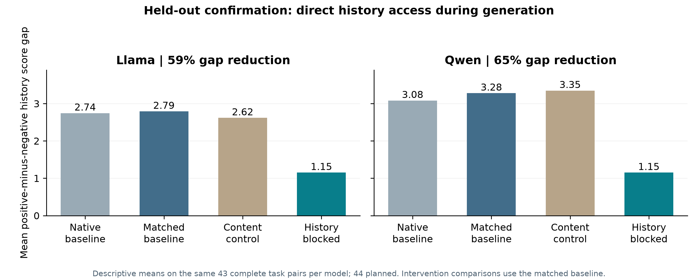
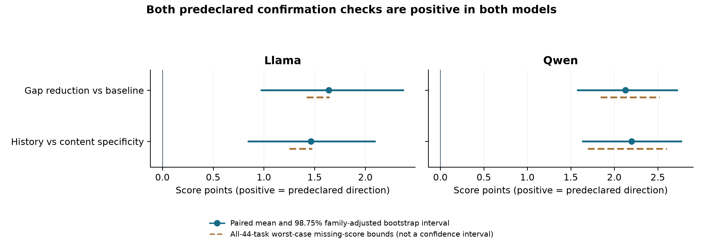

# Held-out history-reading confirmation: audited interpretation

## Main finding in simple language

The models continued to use the reported prior rating while composing their evaluations. Preventing generated input-token readers from attending directly to the history sentence substantially reduced the positive-versus-negative history score gap, even though prompt processing and the judged answers were unchanged. This supports a causal contribution from that access route on tasks held out from the documented mechanistic experiments.

It does not identify a complete circuit, a particular layer/head, or a psychological motive. A score gap of about 1.15 points remained, and calibration/anchoring remains compatible with the result.

## Integrity checks

- The Mac archive checksum matches, and all 184 archived files match the extracted copies.
- All 704 planned confirmation records are present: 352 per model, from 44 tasks x two histories x four arms.
- All 12 engineering rechecks passed. The generated-reader first-prediction boundary is preserved on all 176 condition cases across both models.
- Native prompt token IDs are identical across all four arms within every task/history condition (176 checks).
- Actual source files, plan, protocol, exposure review and lock match the original prospective frozen inputs exactly.
- The saved analysis was independently reproduced from raw records, including every reported interval and missingness bound.
- There are 694 valid score outputs and 10 capped unfinished outputs (Qwen 7, Llama 3). All incomplete outputs concern one WildBench task, wildbench/ca7d8fdc596240d8. They stay missing, never zero or retrospectively recovered.

## Fair paired comparison

The table uses the same 43 all-arm-complete tasks per model. This avoids comparing different task subsets. Llama history-blocking has 44 valid standalone pairs, but its 44-task mean is not used in the paired 43-task effect calculation.

| Mean positive-minus-negative history score gap, points | Llama 3.1 8B | Qwen3 8B |
|---|---:|---:|
| Native Hugging Face baseline | 2.744 | 3.081 |
| Matched explicit-mask baseline | 2.791 | 3.279 |
| Same-count question/answer-key control | 2.616 | 3.349 |
| History-key blocking for generated readers | 1.151 | 1.151 |
| Paired reduction from matched baseline | **1.640 (58.75%)** | **2.128 (64.89%)** |

The percentages describe reductions of the paired mean score gap. They are not percentages of neurons, all history information, a unique mediated effect, or a complete mechanism identified.

## Predeclared statistical checks

Both predeclared outcomes pass in both models. Confidence intervals below are two-sided 98.75% stratified paired-task bootstrap intervals, adjusting the four-test family (two outcomes x two models), 100,000 draws. This was a focused confirmation selected prospectively from the earlier reported pilot; the pilot itself remains exploratory.

| Outcome | Llama mean [adjusted interval] | Qwen mean [adjusted interval] |
|---|---:|---:|
| Gap reduction versus matched baseline | 1.640 [0.977, 2.372] | 2.128 [1.581, 2.721] |
| History-blocking advantage over content control | 1.465 [0.849, 2.093] | 2.198 [1.640, 2.767] |

All four interval lower limits exceed zero. Also, assigning every missing score the worst legally possible value on the 0-10 scale leaves the all-44-task mean contrasts positive: Llama baseline reduction >=1.420 points and specificity >=1.250; Qwen reduction >=1.841 and specificity >=1.693. These are deterministic missing-score bounds, not confidence intervals or proof that missingness is random.

On the common 43 tasks, the gap decreased on 30 Llama tasks, was unchanged on 10 and increased on 3. For Qwen it decreased on 36 and was unchanged on 7. Thus the effect is neither universal nor dependent on a single favorable example.

## What the native baseline tells us

The original Hugging Face generation path also has a large history gap. The explicit-minus-native gap difference is +0.047 points in Llama (descriptive 95% interval [-0.151, 0.256]) and +0.198 in Qwen ([0.035, 0.360]). In Qwen, that complete-case interval excludes zero, although all-task missing-score bounds include zero. Neither result proves path equivalence. Consequently, causal ablation magnitudes are reported against their matched explicit-mask baseline; they are not presented as interventions run in the untouched native path.

## Why this addresses the assigned mechanistic task

The earlier single-state replacement experiments asked whether a localized state could transfer history-sensitive scoring. Most patches did little, and combining them with generated-reader blocking did not reliably enhance transfer in the pilot. This does not rule out distributed information or other carriers.

The new experiment asks a different causal question: does continuing to access history during generation contribute to the effect? Prompt processing proceeds normally; the intervention affects only attention from generated input tokens to history keys. The unchanged first prediction is checked. Direct access to the history sentence is the tested route, across all decoder blocks (32 Llama, 36 Qwen). The content control uses the same number of blocked keys, layers and readers, helping distinguish the result from merely blocking some attention links. Question/answer keys are not inert or position-matched, so the control does not eliminate every possible disruption explanation.

The temporal/access-route hypothesis now generalizes to held-out task identities in both judges. The route is supported, while a full layer/head-localized mechanism is not established. Remaining history effects can travel through unblocked prompt states or previously generated tokens; blocking this route is not erasing history from the network.

The recorded held-out pool is 21 Arena-Hard, 22 WildBench and one MT-Bench task. Its membership avoids all task IDs and exact-question hashes found in the 94-file documented exposure audit. This is not a balanced three-benchmark replication, evidence of semantic novelty, behavioral non-exposure, absence from pretraining, or a claim about unknown/unrecorded experiments.

## How to use this in the rebuttal

- **VYCX: narrow mechanistic evidence and Qwen null patching.** Add this held-out, free-generation intervention result for both architectures, including Qwen. Retain the original negative patching/steering results and unsuccessful combined-patch pilot. Describe causal contribution, not complete mediation or a unique state carrier.
- **VYCX: history presence mixed with valence.** Both high/low arms contain history sentences and keep judged content fixed. The new matched-history contrast and matched computation-path controls avoid comparing a sentence-present arm with no_history for this mechanistic claim.
- **ubVp: calibration versus retaliation.** The new result identifies where/how contextual history remains causally available; it does not resolve whether the numerical shift reflects calibration, anchoring or socially framed bias. Narrow the language to sensitivity to attributed history. Include full prompts/rubric/chat template and sentence position in the paper, rather than relying on code alone.
- **sQ5Z: mechanistic narrative and model relevance.** The route intervention connects behavior to internal attention during evaluation and confirms on new task identities. It remains an 8B-model result, not frontier-model validation.
- **Silence, systematic factual criticisms and actual multi-agent interactions.** These experiments did not measure factual-criticism frequency, explanation faithfulness or actual interaction histories. Do not imply those concerns are newly resolved.

### Suggested rebuttal paragraph

We agree that the original single-state patching evidence does not establish a general mechanism. We therefore conducted a prospectively frozen confirmation on 44 tasks held out from the documented mechanistic experiments, using Llama-3.1-8B and Qwen3-8B with free-generation scoring. Keeping prompt processing unchanged, blocking attention from generated-token readers to history keys reduced the paired high-minus-low score gap by 1.64 points in Llama and 2.13 in Qwen (43 complete task pairs; four-test-adjusted 98.75% intervals [0.98, 2.37] and [1.58, 2.72]). Reductions exceeded those from a same-count question/answer-key control in both models, and planned-task mean effects remained positive under worst-case missing-score bounds. This supports a causal contribution of direct history access during generation, while leaving a residual gap and not establishing a complete circuit, retaliation, or a distinction from calibration/anchoring.

## What remains

For the narrower assigned objective, the preparation, discovery pilot and held-out route confirmation are complete and audited. No further GPU experiment is required to support this limited claim. The next necessary work is manuscript/rebuttal integration, appropriate figures and transparent reporting of all successful, null and unusable experiments.

The rationale-prefix experiment remains technically inconclusive because its generation limits caused extensive missing data. Repair and repilot it only if making a claim about rationale carryover; do not reinterpret its truncated scores. Layer/head localization would be further discovery work, followed by a new independent holdout, not a prerequisite for the present route-contribution claim. The 44 confirmation tasks are now mechanistically exposed and must not be reused as a new untouched tuning holdout; a post-confirmation registry is included.

Additional frontier models, realistic interaction memories, calibration-specific controls and systematic factual-criticism auditing would address other reviewer concerns but were not completed here. Claims should be narrowed accordingly if those are outside the rebuttal budget.

The completed confirmation took about 43.8 minutes for Qwen and 35.5 for Llama, including their rechecks. The verified Mac backup contains the necessary records and source; the Vast GPU can remain stopped.
